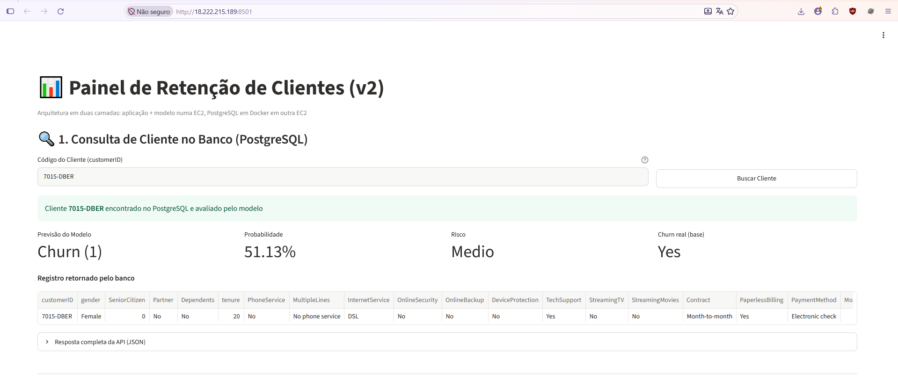
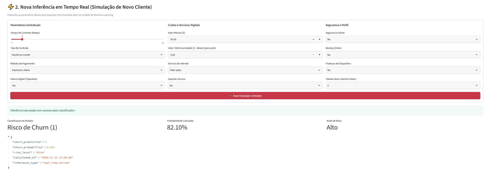

# Previsão de Churn — Projeto Prático de MLOps

Projeto da disciplina **Engenharia de Machine Learning Aplicada — princípios de MLOps** (IESB, Ciência de Dados e IA).

O objetivo da disciplina não é a acurácia do modelo, e sim o **encanamento ao redor dele**. O ponto de partida é um script de churn que "só funciona na minha máquina" (`train_churn.py`, fornecido em aula); a cada encontro, uma dor de reprodutibilidade motiva uma ferramenta nova. O resultado é um sistema que valida e versiona os dados, rastreia experimentos, registra o melhor modelo e serve previsões em uma arquitetura de duas camadas na AWS.

O plano completo da disciplina está em [`grade-mlops-60h.md`](grade-mlops-60h.md).

---

## Sumário

1. [O dado e o problema](#1-o-dado-e-o-problema)
2. [Arquitetura final (AWS, duas camadas)](#2-arquitetura-final-aws-duas-camadas)
3. [Linha do tempo: o que cada etapa construiu](#3-linha-do-tempo-o-que-cada-etapa-construiu)
4. [Um modelo, do treino à produção](#4-um-modelo-do-treino-à-produção)
5. [Estrutura do repositório](#5-estrutura-do-repositório)
6. [Como executar](#6-como-executar)
7. [Limitações conhecidas](#7-limitações-conhecidas)

---

## 1. O dado e o problema

Classificação binária: prever se um cliente vai cancelar o serviço (`Churn = Yes/No`). O dataset e o modelo base (Random Forest) foram **fixados pelo professor**.

| Característica | Valor |
| --- | --- |
| Arquivo | `data/raw/churn.csv` (versionado com DVC, não com Git) |
| Linhas × colunas | 7.043 clientes × 21 colunas |
| Identificador | `customerID` (único; ex.: `7000-QFVW`, `7015-DBER`) |
| Alvo | `Churn`: 4.752 `No` / 2.291 `Yes` (**32,5 % de churn**) |
| Numéricas | `tenure` (0–72 meses), `MonthlyCharges` (18,25–118,75), `TotalCharges` (texto no CSV; 11 valores em branco) |
| Categóricas | 16 colunas (contrato, serviços, forma de pagamento etc.) |

---

## 2. Arquitetura final (AWS, duas camadas)

```text
[Navegador]
     │ HTTP :8501
     ▼
┌── AWS us-east-2 (VPC padrão) ─────────────────────────────────────────────────┐
│                                                                               │
│  EC2 churn-app-host ("Modelo Servidor")         EC2 churn-db-host             │
│  role IAM EC2-ECR-ReadRole (sem chaves fixas)                                 │
│  ┌── container (imagem do ECR) ──────┐          ┌── container churn_postgres ┐│
│  │ Supervisord                       │  SQL     │ PostgreSQL 15              ││
│  │  ├─ Streamlit :8501 app_churn_v2  │  :5432   │ banco churn_db             ││
│  │  └─ FastAPI   :8000 src/api_v2 ───┼─────────►│ tabela customers           ││
│  │     + modelo em memória           │ IP priv. │ (churn.csv bruto, 7.043)   ││
│  └───────────────────────────────────┘          └────────────────────────────┘│
│                ▲ docker pull                                                  │
│        Amazon ECR: app-churn-v1:latest                                        │
└───────────────────────────────────────────────────────────────────────────────┘
```

* **Camada de aplicação:** um único container roda o backend (FastAPI) e o frontend (Streamlit), gerenciados pelo Supervisord. A imagem é publicada no Amazon ECR e baixada pela EC2 usando uma *IAM Role* (credenciais temporárias, nada de chave gravada em disco).
* **Camada de dados:** PostgreSQL em Docker numa segunda EC2. O `churn.csv` bruto foi carregado na tabela `customers` (`CSV → postgres`).
* As duas máquinas conversam pelo **IP privado** da VPC; a senha do banco entra no container em tempo de execução (`--env-file`) e nunca vai para o Git nem para a imagem.

Evidências (painel em produção na AWS):

| Bloco 1 — consulta por código no PostgreSQL | Bloco 2 — nova inferência em tempo real |
| --- | --- |
|  |  |

---

## 3. Linha do tempo: o que cada etapa construiu

A disciplina segue os **três pipelines do ml-ops.org** (Data, ML e Software Code). Cada etapa abaixo traz a dor que a motivou, o que foi entregue e onde está no repositório.

### Bloco 0 — Fundação

**Encontros 1 e 2 · Git e estrutura de projeto.**
*Dor:* um script único (`train_churn.py`) que ninguém consegue rodar, revisar ou colaborar.
*Entrega:* o script foi quebrado em módulos por responsabilidade em `src/` (`config`, `data`, `features`, `models`, `evaluate`) e costurado por `run_pipeline.py`. O trabalho foi feito na branch `refactor/estrutura` e entrou na `main` pelo **Pull Request #1** (17/08).

**Encontro 3 · Docker.**
*Dor:* o projeto modular ainda dependia do ambiente de cada máquina.
*Entrega:* `Dockerfile.treino` empacota o pipeline modular numa imagem (`churn:0.1`) sobre a base oficial do `uv`. As dependências vêm do `pyproject.toml`, travadas no `uv.lock`, e são instaladas **antes** do código, para aproveitar o cache de camadas. O `churn.csv` não entra na imagem: chega por volume, e o modelo treinado sai pelo volume `models/`.

```powershell
docker build -f Dockerfile.treino -t churn:0.1 .
docker run --rm -v "${PWD}/data:/app/data" -v "${PWD}/models:/app/models" churn:0.1
```

### Bloco 1 — Data Pipeline

**Encontro 4 · Profiling e validação de dados (Pandera).**
*Dor:* dado sujo quebra o treino em silêncio.
*Entrega:*
* `src/profiling.py`: retrato do dado (tipos, estatísticas, nulos, distribuição do alvo).
* `src/schema.py`: o **contrato de dados** `ChurnSchema` — `customerID` único, `tenure` entre 0 e 72, `MonthlyCharges` entre 18 e 120, `TotalCharges ≥ 0`, `Contract` e `Churn` só com categorias válidas.
* `src/data.py`: `load_clean_data()` converte `TotalCharges` para número e valida o dado contra o contrato **antes** de qualquer feature (`lazy=True` junta todas as falhas).
* `test_schema.py`: quebra o contrato de propósito em 3 linhas reais da base. Saída:

```text
        column                                            check failure_case
    customerID                                 field_uniqueness    7000-QFVW
    customerID                                 field_uniqueness    7000-QFVW
        tenure                        less_than_or_equal_to(72)          999
MonthlyCharges                   greater_than_or_equal_to(18.0)        -15.0
      Contract isin(['Month-to-month', 'One year', 'Two year'])    Vitalicio
```

**Encontro 5 · Versionamento de dados (DVC).**
*Dor:* "mudei o dataset e não sei qual modelo veio de qual versão".
*Entrega:*
* O `churn.csv` saiu do Git; no Git fica só o ponteiro `data/raw/churn.csv.dvc` (hash MD5 do conteúdo). Os bytes ficam no cache/remote do DVC.
* Remote local configurado em `.dvc/config`.
* Duas versões registradas e alternadas: a **v1** (base original, commit `56faa71`) e uma **v2** criada para o exercício, com uma linha extra `9999-DUMMY` mal formatada (commit `e6bcaf0`).
* Um bom exemplo de Data Pipeline funcionando: ao treinar com a v2, o **Pandera barrou a linha suja** (`tenure` com texto, `Contract` inválido, `Churn` nulo). A linha foi removida e o ponteiro atual volta ao conteúdo original: `md5 d390bd07…`, 981.685 bytes — o mesmo hash do slide do Encontro 5. O ponteiro da v1 tinha hash `3a29edd8…` porque, naquela época, o arquivo estava com quebras de linha do Windows (CRLF); o conteúdo é o mesmo.

### Bloco 2 — ML Pipeline (MLflow)

**Encontro 6 · Tracking de experimentos.**
*Dor:* "rodei vários experimentos e perdi qual foi o melhor".
*Entrega:*
* `src/train_mlflow.py`: treino com `mlflow.sklearn.autolog()` e tags de linhagem (`data_md5` do ponteiro DVC + `git_commit`).
* `src/experiments.py`: **grid de 9 runs** (`n_estimators` ∈ {100, 200, 500} × `max_depth` ∈ {None, 8, 16}) no experimento `churn-prediction`, com backend SQLite (`mlflow.db`).

Resultado do grid (acurácia no teste, 20 % estratificado, `random_state=42`):

| run | n_estimators | max_depth | test_accuracy |
| --- | --- | --- | --- |
| **rf-n200-d8** | 200 | 8 | **0,7729** |
| rf-n500-d8 | 500 | 8 | 0,7715 |
| rf-n100-d8 | 100 | 8 | 0,7715 |
| rf-n100-d16 | 100 | 16 | 0,7672 |
| rf-n500-d16 | 500 | 16 | 0,7594 |
| rf-n500-dNone | 500 | None | 0,7559 |
| rf-n200-d16 | 200 | 16 | 0,7559 |
| rf-n100-dNone | 100 | None | 0,7523 |
| rf-n200-dNone | 200 | None | 0,7502 |

`max_depth=8` domina; árvores mais profundas pioram (overfitting).

**Encontro 7 · Model Registry.**
*Entrega:* `src/register_model.py` busca o melhor run por código (`mlflow.search_runs` ordenado por `test_accuracy`), registra-o como **`churn-model`** e aponta o alias **`@champion`** para essa versão. `src/test_champion.py` consome o modelo pela URI estável `models:/churn-model@champion` (flavor `pyfunc`). A cadeia de linhagem fica completa: dado (DVC) → código (Git) → experimento (MLflow) → modelo (`@champion`).

**Orquestração do ML Pipeline com DVC.** `dvc.yaml` declara duas etapas, `treino_e_tuning` (`python -m src.experiments`) e `promover_modelo` (`python -m src.register_model`), executadas com `dvc repro`.

### Serviço do modelo

**FastAPI + MLflow (`src/main.py`).**
*Tarefa:* o usuário informa o código do cliente e recebe a predição do `@champion` junto com as informações do modelo.
*Rotas:*
* `GET /predict/{customer_id}`
* `POST /predict` — permite simular outros valores de `tenure`, `MonthlyCharges` e `TotalCharges` para um cliente existente.
* `GET /model-info` — versão, run, acurácia, hiperparâmetros e linhagem.

As features são montadas com as **mesmas funções do treino**. Para `7015-DBER`, a API devolve `churn_prediction = 0`, idêntico ao modelo aplicado diretamente sobre a base.

**Streamlit + docker compose.** `streamlit_app.py` é um painel para essa API. `docker-compose.yml` sobe os dois serviços (`Dockerfile.api` e `Dockerfile.streamlit`). A imagem da API copia o `mlflow.db` e o `mlruns/` locais, então as etapas do MLflow precisam ter sido executadas antes do `docker compose up --build`.

### Deploy na AWS

**app-churn-v1 · uma imagem Docker para front e backend, sem inferência.**
*Pedido:* "Como sirvo um modelo de ML usando uma mesma imagem Docker para front e backend? Não faz inferência; apenas consulta resultados já existentes."
*Entrega:*
* `src/batch_scoring.py` aplica o `@champion` aos 7.043 clientes reais em lote e grava `data/batch_predictions.parquet`.
* `src/api_lookup.py` (FastAPI) apenas consulta esse arquivo.
* `app_churn_v1.py` (Streamlit) é a tela.
* O `Dockerfile` + `supervisord.conf` juntam tudo num container.
* A imagem é publicada no ECR (`infra/deploy_ecr.ps1`) e executada numa EC2 (`infra/setup_ec2.sh`) com IAM Role (`infra/iam_trust_ec2.json`).

**app-churn-v2 · inferência em tempo real.**
*Pedido:* a API passa a receber parâmetros para uma nova inferência; a tela tem a consulta por código e um bloco "nova inferência" com o resultado na tela.
*Entrega:*
* `src/api_v2.py` com `POST /predict`.
* `app_churn_v2.py` com os dois blocos.

**app-churn-v2 em duas camadas (PostgreSQL).**
*Pedido:* uma EC2 com o Docker do app/modelo, outra EC2 com PostgreSQL em Docker e o CSV carregado no banco.
*Entrega:*
* `infra/setup_db_ec2.sh` e `infra/db/init_customers.sql` sobem o Postgres e carregam o `churn.csv` bruto (`COPY 7043`).
* `src/db.py` conecta via variáveis de ambiente.
* `src/api_v2.py` passa a fazer `SELECT` no banco e o `@champion` calcula o score sobre o registro retornado (`GET /model-info` mostra a versão em uso).
* `app_churn_v2.py` mostra o registro do banco, a previsão e o churn real.

Resultado: `7015-DBER` → 47,16 %, classe 0 (risco Médio), churn real `Yes`, `data_source: postgresql`, modelo `churn-model` @champion (`rf-n200-d8`).

---

## 4. Um modelo, do treino à produção

Todos os serviços do projeto usam **o mesmo modelo**: a versão do `churn-model` apontada pelo alias `@champion` no MLflow Model Registry (hoje, o run `rf-n200-d8`).

```text
churn.csv (DVC) → src/experiments.py (grid MLflow) → src/register_model.py (@champion)
               → src/export_champion.py (models/champion/) → docker build → ECR → EC2
```

* **Contrato de features.** O modelo recebe números, mas os dados chegam como texto (`"Female"`, `"Month-to-month"`...). Cada run do grid salva no MLflow um `feature_contract.json` com o código de cada categoria e a ordem das colunas usadas no treino. A inferência (`src/features.py → features_for_inference`) aplica esse contrato, então um cliente vindo do PostgreSQL ou do formulário é transformado **exatamente** como no treino. Categoria fora do contrato (ex.: `Contract = "Vitalicio"`) é recusada com erro 422, sem chute.
* **Exportação.** O Model Registry vive no `mlflow.db` local. Antes do build, `src/export_champion.py` copia para `models/champion/` o pacote MLflow Models da versão `@champion`, o contrato de features e um `champion_info.json` com versão, run, acurácia e linhagem (`data_md5` do DVC + `git_commit`). O `infra/deploy_ecr.ps1` faz isso automaticamente.
* **Mesmo ambiente.** O MLflow salva com o modelo as versões exatas das bibliotecas do treino (`models/champion/requirements.txt`), e a imagem instala exatamente essas versões.
* **Quem usa.** API do MLflow (`src/main.py`, carregando do registry), API da v2 (`src/api_v2.py`), lote da v1 (`src/batch_scoring.py`). Para `7015-DBER`, todos respondem probabilidade **0,4716** → classe 0 (risco Médio); o churn real desse cliente é `Yes`, um erro do modelo perto da fronteira de decisão.
* **Verificação.** As probabilidades do lote foram comparadas com o `@champion` carregado direto do registry para os 7.043 clientes: diferença máxima de 0,0.

---

## 5. Estrutura do repositório

```text
mlops-churn-project/
├── README.md                  ← este documento
├── grade-mlops-60h.md         ← plano da disciplina (professor)
├── pyproject.toml / uv.lock   ← dependências travadas do container de treino (Encontros 2–3)
├── Dockerfile.treino          ← Encontro 3: imagem churn:0.1 que roda o run_pipeline.py
├── requirements.txt           ← dependências do ambiente local de desenvolvimento (e do Dockerfile.api)
├── requirements-app.txt       ← dependências extras da imagem da aplicação AWS (banco, Streamlit)
├── .env.example               ← modelo das variáveis de conexão com o banco (o .env real é ignorado)
├── .gitignore / .dvcignore
│
├── data/raw/
│   ├── churn.csv.dvc          ← ponteiro DVC do dataset (o CSV em si não vai para o Git)
│   └── .gitignore
├── .dvc/config                ← remote DVC (local)
├── dvc.yaml                   ← pipeline DVC: treino_e_tuning → promover_modelo
│
├── run_pipeline.py            ← Bloco 0: pipeline modular (validar → features → treinar → avaliar → salvar)
├── test_schema.py             ← Bloco 1: quebra proposital do contrato Pandera
├── src/
│   ├── config.py              ← caminhos e hiperparâmetros num lugar só
│   ├── data.py                ← carga + validação com o ChurnSchema
│   ├── schema.py              ← contrato de dados (Pandera)
│   ├── profiling.py           ← profiling do dataset
│   ├── features.py            ← engenharia de atributos e encoding
│   ├── models.py              ← treino do Random Forest
│   ├── evaluate.py            ← métrica e serialização do modelo
│   ├── train_mlflow.py        ← Bloco 2: treino com autolog + linhagem
│   ├── experiments.py         ← Bloco 2: grid de 9 runs no MLflow
│   ├── register_model.py      ← Bloco 2: registry + alias @champion
│   ├── test_champion.py       ← Bloco 2: consumo de models:/churn-model@champion
│   ├── main.py                ← FastAPI servindo o @champion
│   ├── export_champion.py     ← exporta o @champion do registry para models/champion/ (antes do build)
│   ├── batch_scoring.py       ← AWS v1: pontuação em lote → parquet
│   ├── api_lookup.py          ← AWS v1: API de consulta ao parquet
│   ├── api_v2.py              ← AWS v2: consulta no PostgreSQL + inferência online
│   ├── db.py                  ← AWS v2: conexão com o PostgreSQL via variáveis de ambiente
│   └── inference.py           ← AWS: carrega o @champion exportado e calcula as probabilidades
│
├── streamlit_app.py           ← painel da API do @champion
├── docker-compose.yml         ← sobe API (Dockerfile.api) + painel (Dockerfile.streamlit)
├── Dockerfile.api / Dockerfile.streamlit
│
├── app_churn_v1.py            ← tela da app-churn-v1 (consulta em lote)
├── app_churn_v2.py            ← tela da app-churn-v2 (consulta no banco + nova inferência)
├── Dockerfile                 ← imagem única da aplicação AWS (FastAPI + Streamlit)
├── supervisord.conf           ← processos dentro do container (backend :8000, frontend :8501)
│
├── infra/
│   ├── README.md              ← topologia e passo a passo de implantação na AWS
│   ├── deploy_ecr.ps1         ← build + push da imagem para o ECR (Windows)
│   ├── setup_ec2.sh           ← deploy na EC2 da aplicação
│   ├── setup_db_ec2.sh        ← provisiona o PostgreSQL na EC2 do banco
│   ├── iam_trust_ec2.json     ← trust policy da role EC2-ECR-ReadRole
│   └── db/init_customers.sql  ← DDL da tabela customers + carga do CSV
└── docs/img/                  ← evidências do painel em produção
```

Artefatos gerados localmente e **ignorados pelo Git**: `mlflow.db`, `mlruns/`, `models/`, `data/batch_predictions.parquet`, `.venv/`, `.env`.

---

## 6. Como executar

Pré-requisitos: Python 3.11+, Git, DVC e Docker. Os comandos abaixo são do **PowerShell (Windows)**, na raiz do projeto.

```powershell
python -m venv .venv
.\.venv\Scripts\Activate.ps1
pip install -r requirements.txt
python -m dvc pull                       # baixa o churn.csv do remote DVC (veja a seção 7)
```

**Pipeline modular dentro do container (Encontro 3)**
```powershell
docker build -f Dockerfile.treino -t churn:0.1 .
docker run --rm -v "${PWD}/data:/app/data" -v "${PWD}/models:/app/models" churn:0.1
```

**Data Pipeline e pipeline modular**
```powershell
python -m src.profiling                  # retrato do dataset
python test_schema.py                    # o contrato pandera barrando dados adulterados
python run_pipeline.py                   # valida → features → treina → avalia → salva models/churn_rf.pkl
```

**ML Pipeline (MLflow)**
```powershell
python -m src.experiments                # grid de 9 runs
python -m src.register_model             # registra o melhor e aplica @champion
python -m src.test_champion              # consome models:/churn-model@champion
python -m mlflow ui --backend-store-uri sqlite:///mlflow.db   # http://127.0.0.1:5000
python -m dvc repro                      # alternativa: roda as duas etapas pelo dvc.yaml
```

**API do @champion + painel**
```powershell
python -m uvicorn src.main:app --port 8000 --reload          # http://127.0.0.1:8000/docs
streamlit run streamlit_app.py
```

**app-churn-v2 (local, conectando no PostgreSQL da AWS)**
```powershell
copy .env.example .env                   # preencha DB_HOST (IP público da churn-db-host) e DB_PASSWORD
python -m src.export_champion            # copia o @champion do registry para models/champion/
python -m uvicorn src.api_v2:app --port 8000 --reload
streamlit run app_churn_v2.py
```

**Deploy na AWS:** veja [`infra/README.md`](infra/README.md).

---

## 7. Observações

* **Dependências parcialmente travadas:** o container de treino (`uv.lock`) e as bibliotecas do modelo na imagem da AWS (`models/champion/requirements.txt`) têm versões exatas; o `requirements.txt` do ambiente local e o `requirements-app.txt` declaram versões mínimas (`>=`).
* **Testes:** a validação de dados tem um script de quebra proposital (`test_schema.py`), mas o projeto ainda não tem uma suíte `pytest`.
* **Etapas do plano não implementadas neste repositório:** orquestração com Airflow, CI/CD com GitHub Actions e monitoramento de drift com Evidently (previstos na `grade-mlops-60h.md`).
* **IP público das EC2:** muda a cada parada/início das instâncias. A comunicação entre as máquinas usa o IP privado e não é afetada.
